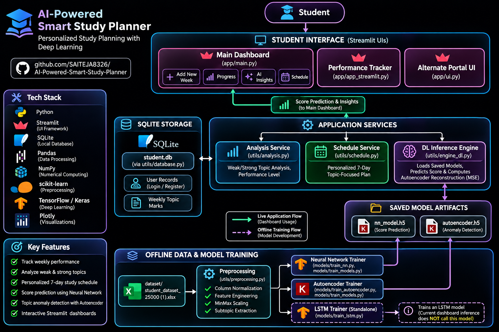

# 🎓 AI-Powered Student Performance Analysis & Smart Study Planner

> A Deep Learning-based Student Performance Tracking System that analyzes weekly academic progress, identifies weak topics, visualizes performance trends, and generates personalized study plans.

## 🏗️ System Architecture

The diagram below shows the Streamlit interfaces, SQLite persistence, analytics and scheduling utilities, and the separate model-training workflow.




---

## 🚀 Project Overview

The AI-Powered Student Performance Analysis & Smart Study Planner is an intelligent educational analytics platform developed using Python, Streamlit, SQLite, and Deep Learning techniques.

The system allows students to:

✅ Register and Login securely  
✅ Enter weekly marks for individual topics  
✅ Store academic records permanently  
✅ Track performance across multiple weeks  
✅ Visualize progress using interactive charts  
✅ Detect weak and strong topics automatically  
✅ Receive AI-based recommendations  
✅ Generate personalized study schedules  
✅ Monitor improvement over time

The project demonstrates how Artificial Intelligence and Educational Data Analytics can be used to improve learning outcomes through personalized guidance.

---

# 📌 Features

### 👤 User Management
- Student Registration
- Student Login Authentication
- Secure Data Storage

### 📚 Weekly Performance Tracking
- Add marks every week
- Store historical records
- Track progress continuously

### 📊 Performance Analysis
- Subject-wise Analysis
- Topic-wise Analysis
- Overall Percentage Calculation
- Strong Topic Detection
- Weak Topic Detection

### 📈 Interactive Visualization
- Marks Comparison Bar Graph
- Weekly Progress Tracker
- Subject Performance Charts
- Historical Performance Dashboard

### 🧠 AI / Deep Learning Module
- Neural Network Model
- LSTM Model
- Autoencoder Model
- Performance Pattern Analysis
- Learning Trend Detection

### 📅 Smart Study Planner
- Personalized Study Schedule
- Topic Prioritization
- Weak Area Focus Planning
- Weekly Revision Recommendations

### 💾 Database Support
- SQLite Database Integration
- Persistent Storage
- Multi-week Tracking

---

# 🛠 Technologies Used

| Technology | Purpose |
|------------|---------|
| 🐍 Python | Core Programming Language |
| 🎨 Streamlit | User Interface Development |
| 📊 Pandas | Data Processing & Analysis |
| 📈 Plotly | Data Visualization |
| 💾 SQLite | Database Management |
| 🤖 TensorFlow / Keras | Deep Learning Models |
| 🔢 NumPy | Numerical Computation |
| 📉 Scikit-Learn | Preprocessing & Evaluation |

---

# 📂 Project Structure

```text
AI-STUDENT-PERFORMANCE-SYSTEM
│
├── app/
│   ├── app_streamlit.py
│   ├── main.py
│   └── ui.py
│
├── dataset/
│   └── student_dataset_25000.xlsx
│
├── models/
│   ├── saved_models/
│   │
│   ├── save_models.py
│   ├── train_autoencoder.py
│   ├── train_lstm.py
│   ├── train_models.py
│   └── train_nn.py
│
├── utils/
│   ├── analysis.py
│   ├── database.py
│   ├── engine_dl.py
│   ├── evaluation.py
│   ├── preprocessing.py
│   └── schedule.py
│
├── venv/
│
├── student.db
├── README.md
└── .gitignore
```

---

# 📊 Dataset Information

### Dataset File

```text
dataset/student_dataset_25000.xlsx
```

### Features Used

#### Mathematics
- Algebra
- Calculus
- Trigonometry
- S&P
- Coordinate Geometry

#### Physics
- Mechanics
- Optics
- Thermodynamics
- Waves
- Electricity

#### Chemistry
- Organic Chemistry
- Inorganic Chemistry
- Physical Chemistry

### Additional Features

- Attendance
- Study Hours
- Subject Totals
- Weekly Performance Records

---

# 🧠 Deep Learning Architecture

The system incorporates multiple deep learning models for performance analytics.

## 1️⃣ Neural Network Model

```text
Input Layer
     ↓
Dense Layer (64)
     ↓
Dense Layer (32)
     ↓
Output Layer
```

### Purpose
- Performance Classification
- Pattern Detection

---

## 2️⃣ LSTM Model

```text
Input Sequence
      ↓
LSTM Layer
      ↓
Dense Layer
      ↓
Output Layer
```

### Purpose
- Weekly Trend Analysis
- Sequential Learning Patterns

---

## 3️⃣ Autoencoder

```text
Input
 ↓
Encoder
 ↓
Latent Space
 ↓
Decoder
 ↓
Output
```

### Purpose
- Feature Compression
- Hidden Pattern Extraction

---

# 🔄 System Workflow

```text
Student Login
      ↓
Weekly Marks Entry
      ↓
SQLite Database
      ↓
Preprocessing
      ↓
Deep Learning Analysis
      ↓
Performance Metrics
      ↓
Visualization
      ↓
AI Recommendations
      ↓
Study Schedule Generation
```

---

# ⚙️ Installation

## Step 1: Clone Repository

```bash
git clone <repository-url>
cd AI-STUDENT-PERFORMANCE-SYSTEM
```

---

## Step 2: Create Virtual Environment

### Windows

```bash
python -m venv venv
```

### Activate

```bash
venv\Scripts\activate
```

---

## Step 3: Install Dependencies

```bash
pip install -r requirements.txt
```

Or

```bash
pip install streamlit pandas numpy plotly tensorflow scikit-learn openpyxl
```

---

# 🚀 Running the Application

## Run Streamlit App

```bash
streamlit run app/main.py
```

---

## Train Neural Network

```bash
python models/train_nn.py
```

---

## Train LSTM

```bash
python models/train_lstm.py
```

---

## Train Autoencoder

```bash
python models/train_autoencoder.py
```

---

## Train Complete Pipeline

```bash
python models/train_models.py
```

---

# 📸 Application Modules

## 🔐 Login System

- User Registration
- Login Authentication
- Database Verification

---

## ➕ Add Weekly Marks

Students can:

- Enter marks topic-wise
- Save weekly records
- Update future weeks

---

## 📊 Marks Analysis

Provides:

- Topic-wise comparison
- Overall percentage
- Weak topic identification

---

## 📈 Progress Tracker

Displays:

- Weekly Progress Graphs
- Historical Data
- Subject Growth Trends

---

## 🧠 AI Recommendation Engine

Based on performance:

### Below 35%

```text
Critical Performance
```

Recommendations:

- Increase study hours
- Daily revision
- Topic mastery sessions

---

### Between 35% - 70%

```text
Moderate Performance
```

Recommendations:

- Mixed Practice
- Weekly Mock Tests
- Revision Strategy

---

### Above 70%

```text
Excellent Performance
```

Recommendations:

- Advanced Problems
- Competitive Exam Practice
- Peer Teaching

---

## 📅 Smart Study Planner

Generates:

- Weekly Schedule
- Daily Targets
- Revision Plan
- Topic Priorities

---

# 📈 Results

## Performance Tracking

✔ Weekly performance stored successfully

✔ Historical records retrieved correctly

✔ Progress visualization generated

✔ Weak topic identification achieved

✔ Personalized study plans generated

---

## Visualization Results

### Marks Analysis

- Topic-wise Bar Graph
- Maximum vs Obtained Marks
- Percentage Calculation

### Progress Tracking

- Week-wise Comparison
- Subject Growth Analysis

---

## Deep Learning Results

### Neural Network

- Learns student performance patterns
- Detects performance variations

### LSTM

- Captures weekly learning trends
- Analyzes sequential progress

### Autoencoder

- Extracts hidden performance features
- Reduces noise in student data

---

# 🎯 Applications

- Student Performance Monitoring
- Academic Progress Tracking
- Personalized Learning Systems
- Smart Tutoring Platforms
- Coaching Institute Analytics
- Educational Data Mining
- Learning Management Systems (LMS)
- Competitive Exam Preparation

---

# ⚠️ Limitations

- Depends on manual data entry
- Limited real-world academic data
- No real-time LMS integration
- Basic predictive capability

---

# 🔮 Future Enhancements

- Advanced Deep Learning Models
- Performance Prediction Engine
- AI Chatbot Tutor
- Mobile Application
- Cloud Deployment
- Teacher Dashboard
- Parent Monitoring Portal
- Automated Exam Recommendation System

---

# 👨‍💻 Author

**Saiteja Pampati**

B.Tech – Computer Science & Machine Learning

AI & Deep Learning Project

---

# ⭐ If you found this project useful

Please consider giving it a ⭐ on GitHub.
